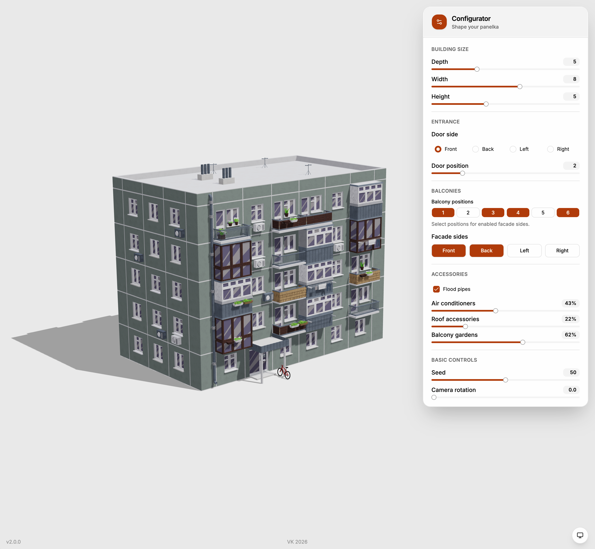

# Panelka Building Configurator

**Version 2.0.0**

Configure a panel apartment building and explore the result in an interactive 3D preview.



## Features

- Set the building's depth, width, and height.
- Choose the entrance side and position.
- Select balcony positions and facade sides.
- Control the probability of air conditioners, roof accessories, and balcony gardens.
- Use a seed to reproduce the same generated building.
- Rotate the camera and switch between system, light, and dark themes.

## Tech stack

- React 18 and TypeScript
- Vite 8
- Three.js, React Three Fiber, and Drei
- Zustand
- Tailwind CSS 4, Base UI, and shadcn/ui

## Getting started

Use Node.js 20.19+ or 22.12+.

```sh
npm install
npm run dev
```

Open the local URL printed by Vite. To show temporary scene development controls, add `?dev=true` to the URL.

## Project checks

```sh
npm run check  # formatting, TypeScript, and lint
npm run build  # production build
npm run preview
```


## Credits

- Art style and inspiration: [Nastya Zhenunk](https://www.artstation.com/artwork/m8ZPZv)
